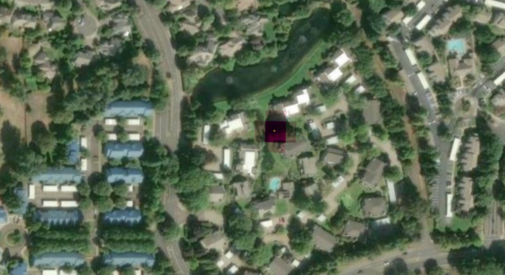

# Pathogen Spread Risk Prototype

An explainable, extensible risk-flagging system for tree health and invasive
pathogen spread. Pathogen behavior (dispersal kernel, host susceptibility,
environmental triggers) lives entirely in config dictionaries, not
hard-coded logic, so new pathogens or data sources can be added without
touching the core engine.

**Status:** prototype scaffold. Scoring, spatial weights, terrain/soil
suitability mappings, and spread-simulation thresholds are documented
domain-judgment placeholders, not a validated predictive model -- see the
caveats in `pathogens.py` and `docs/notes/`.

## How it works

`PathogenPy/spread_engine.py` is a generic spread-risk engine that takes:
- a tree inventory (pandas DataFrame) **or** a raster grid of environmental
  surfaces,
- a pathogen config from `PathogenPy/pathogens.py` (dispersal kernel, host
  susceptibility, environmental triggers, spatial weights, spread-step
  threshold),
- optional environmental surfaces (land cover, soil drainage and water
  attributes, terrain, wetness, wind exposure),
- and optional site wind data (prevailing direction + directionality
  strength), used only for airborne/vector-transmitted pathogens,

and produces an explainable 0-1 risk score per tree (`compute_risk`) or per
grid cell (`compute_risk_raster`). Everything is simple, inspectable math
(distance-decay kernels stretched along the prevailing wind, weighted
environmental match) -- no opaque models.

On top of the engine:
- **Per-tree real-site risk** builds a host inventory from the City of
  Eugene POS tree layer (stdlib shapefile reader, closed-form CRS
  transform, species crosswalk) and ranks host trees near the known cases.
- **Spread simulation** (`spread_simulation.py`) iterates the same per-tree
  hazard over generations with a growing infected set. It is deterministic
  and illustrative -- a what-if trajectory, not a forecast.
- **Tree point export** writes the per-tree results and known cases as
  point shapefiles for direct use in ArcGIS Pro.

Configured pathogens: `red_ring_rot`, `phytophthora`, `anthracnose` (each
with a real Oregon site), and `emerald_ash_borer` (config only, no real
site -- no confirmed case exists).

The real-site pipeline's output GeoTIFF loaded back into `PathogenProject.aprx`,
showing the Red Ring Rot risk raster (dark hotspot, peak at the known case)
over the real parcel:



## Repository layout

```
PathogenPy/              Engine + runnable scripts (plain .venv, no arcpy)
  spread_engine.py          Core dispersal/risk math, generic across pathogens
  spread_simulation.py      Multi-generation what-if spread on an inventory
  pathogens.py              Per-pathogen config dicts
  synthetic_data.py         Synthetic inventory/environment generators
  spatial_inputs.py         Loads real site grids, scores soil/terrain surfaces
  site_tree_inventory.py    Builds per-site host inventory from POS tree layer
  shapefile_reader.py       Stdlib point-shapefile + .dbf reader
  shapefile_writer.py       Stdlib point-shapefile writer (EPSG:32610)
  crs_transform.py          StatePlane OR South (ft) -> UTM 10N (m), stdlib math
  species_crosswalk.py      POS species strings -> engine host keys
  fetch_wind_rose.py        Nearest-station wind rose per site (IEM API)
  run_prototype.py              Synthetic multi-pathogen prototype run
  run_red_ring_rot_grove.py     Synthetic single-pathogen grove scenario
  run_real_site_risk_raster.py  Risk rasters over real site data
  run_real_site_tree_risk.py    Per-tree risk ranking over real sites
  run_real_site_tree_spread.py  Per-tree spread simulation over real sites
  export_tree_points.py         Per-tree CSVs + known cases -> point shapefiles
  arcpy_export/             Scripts that DO require arcpy (see below)
    export_site_layers.py     Exports real GIS data -> flat .npy/.json/.csv
    import_risk_raster.py     Converts computed risk arrays -> GeoTIFF

data/                    Flat, CRS-free exported site data (tracked in git)
  site/, site_phytophthora/, site_anthracnose/
                           Per-pathogen site grids, known cases, grid_meta.json,
                           wind_rose.json, gis_reference/ GeoTIFFs
  POS_Trees_Master/        City of Eugene POS tree layer (point shapefile)

outputs/                 Risk rasters, GeoTIFFs, per-tree CSVs, preview PNGs
  gis/                     Point shapefiles from export_tree_points.py
docs/                    Contract-first artifact chain (see below)
tests/                   pytest tests (grove scenario, spatial inputs)
PathogenProject/         ArcGIS Pro project: .gdb sources, NLCD raster, .aprx
                           (gitignored -- large binary GIS data, stays local)
```

## Setup

The engine (`PathogenPy/`, excluding `arcpy_export/`) only needs a plain
Python environment:

```
python -m venv .venv
.venv\Scripts\activate
pip install numpy pandas matplotlib scipy pytest
```

`PathogenPy/arcpy_export/*.py` is intentionally split out because it needs
**ArcGIS Pro's own Python**, not this venv:

```
"C:\Program Files\ArcGIS\Pro\bin\Python\envs\arcgispro-py3\python.exe" export_site_layers.py
```

The plain `.venv` never imports arcpy/rasterio/geopandas -- it only reads
the flat files that `export_site_layers.py` writes to `data/`. Shapefile
I/O and the CRS transform are stdlib-only for the same reason.

## Running it

**Synthetic prototypes** (no real data required):
```
python PathogenPy/run_prototype.py
python PathogenPy/run_red_ring_rot_grove.py
```

**Real-site raster pipeline** (requires `PathogenProject/` GIS data locally):
```
# 1. Export real GIS data to flat files (ArcGIS Pro Python)
"C:\Program Files\ArcGIS\Pro\bin\Python\envs\arcgispro-py3\python.exe" PathogenPy\arcpy_export\export_site_layers.py

# 2. Fetch each site's wind rose (plain .venv, needs internet)
python PathogenPy\fetch_wind_rose.py

# 3. Compute risk rasters (plain .venv)
python PathogenPy\run_real_site_risk_raster.py

# 4. Convert results back to georeferenced GeoTIFFs (ArcGIS Pro Python)
"C:\Program Files\ArcGIS\Pro\bin\Python\envs\arcgispro-py3\python.exe" PathogenPy\arcpy_export\import_risk_raster.py
```
Re-run step 1 whenever the source `.gdb` data changes; no code changes are
needed elsewhere. Step 2 only needs re-running if a site's AOI moves.
`data/` is tracked, so steps 1-2 can be skipped on a fresh clone. Load the
resulting `outputs/*.tif` into `PathogenProject.aprx` to view (add layers +
save from the Pro UI -- scripting `aprx.save()` headlessly hangs, see
`docs/notes/`).

**Real-site per-tree pipeline** (plain .venv, uses tracked `data/` only):
```
python PathogenPy\run_real_site_tree_risk.py     # ranked per-tree risk CSV + preview
python PathogenPy\run_real_site_tree_spread.py   # spread CSV, epidemic curve, frames
python PathogenPy\export_tree_points.py          # CSVs -> outputs/gis/*.shp
```
Run `export_tree_points.py` after the two run scripts; it only converts
their CSVs. Add the `outputs/gis/` shapefiles to `PathogenProject.aprx`
and symbolize by `RISK_SCORE` (risk layers) or `INF_STEP` (spread layers).

**Tests:**
```
pytest tests/
```
Current tests cover the grove scenario and `spatial_inputs.py` only. The
per-tree inventory, spread simulation, and shapefile/CRS modules do not
have tests yet.

## Contract-first artifact chain

This project treats every feature as a chain of artifacts rather than just
code (see `CLAUDE.md` and `docs/artifact_chain.md`):

1. **Contract** (`docs/feature_contracts/<feature>.md`) -- problem, scope,
   inputs/outputs, success criteria.
2. **Design note** (`docs/notes/<feature>.md`) -- approach, assumptions,
   verification results.
3. **Implementation** -- the code.
4. **Verification** -- run it, capture the result.
5. **Summary** (`docs/summaries/<feature>.md`, or the end of the design
   note) -- what changed, what's next.

`docs/project_contract.md` has the overall product goal and planned
evolution. Read `docs/feature_contracts/` and `docs/notes/` for the reasoning
behind specific design choices (e.g. why raster risk mode excludes host
susceptibility, why spatial weights differ per transmission mode, why tree
results export as points instead of a raster).

## Known limitations

- Each real site has only one or two confirmed cases (Red Ring Rot: 1,
  Phytophthora: 1, Anthracnose: 2) -- this is not a fitted/calibrated model.
- Soil drainage-class, slope/aspect, and moisture/temperature suitability
  scores are ordinal domain-judgment placeholders, not sourced from
  pathology literature.
- No real moisture/temperature climate layers are wired in yet.
- Wind comes from one nearest ASOS/AWOS station per site. Willamette Valley
  winds are seasonally bimodal, so a single prevailing direction is a
  simplification (see `docs/notes/real_wind_data.md`).
- Raster risk mode has no per-cell species/stress data, so host
  susceptibility and stress amplification are intentionally left out of it.
- The POS tree layer has no health field, so per-tree `stress_index` is a
  constant default. Species mapping is mostly genus-level.
- Spread simulation generations are abstract dispersal cycles, not seasons
  or years. `promotion_threshold` is an uncalibrated knob.
